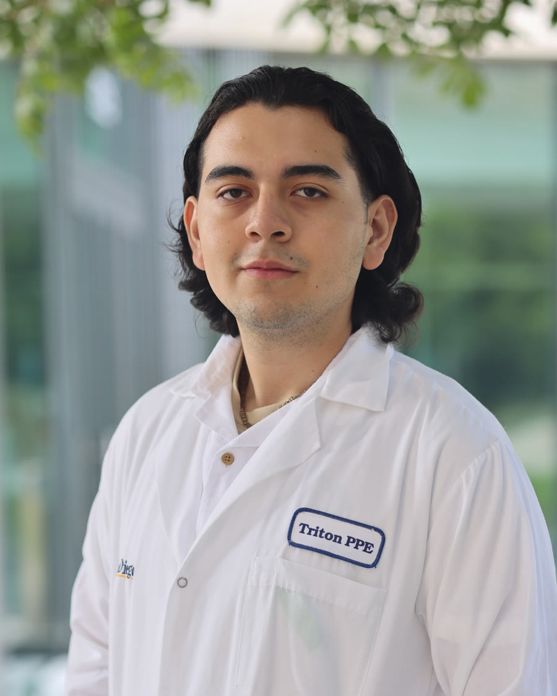

::::: {.hero}
:::: {.hero-photo}
{fig-alt="Headshot of Romeo Velarde-Alvarez"}
::::

:::: {.hero-text}
[Harvey Mudd College · B.S. Engineering · 2028]{.eyebrow}

# Romeo Velarde-Alvarez

Hardware electronics and RF/analog circuit design.

::: {.chips}
[Analog & RF Circuits]{.chip} [PCB Design & Bring-Up]{.chip} [Embedded Systems]{.chip} [Digital / SoC Design]{.chip}
:::

[View Resume](files/Velarde-Alvarez_Resume.pdf){.btn .btn-primary target="_blank"} [See Projects](projects.qmd){.btn .btn-outline-primary} [Email Me](mailto:rnvelardealvarez@gmail.com){.btn .btn-outline-primary}
::::
:::::

I am a junior Engineering major at Harvey Mudd College focused on hardware electronics and RF/analog circuit design. I am building personal electronics and embedded systems projects to strengthen my skills in hardware and software dedicated to circuit design. Through team projects, I have gained experience in electronics, systems, and collaborative problem solving.

I am a researcher in the Cell Biology, Microfluidics, and Tissue Engineering Lab [CuTE](https://www.hmc.edu/engineering/undergraduate-research-experiences/steven-santana-research-group/), where I work on a team developing a multichannel bioprinter for complex tissue models. I am also a part of the Analog Circuit Engineering Lab [ACE](https://www.hmc.edu/engineering/undergraduate-research-experiences/analog-circuit-engineering-lab/), where I am working on the hardware team to integrate the analog circuit PCB, which transmits and receives signals from the studied plant and insect, with the digital microcontroller board.

## Currently

::::: {.current-grid}
::: {.current-item}
[Research]{.current-label}

Designing a low-cost electropenetrography amplifier in the [Analog Circuit Engineering Lab](experience.qmd#ace-lab), and developing a multichannel bioprinter in the [CuTE Lab](experience.qmd#cute-lab).
:::

::: {.current-item}
[Industry]{.current-label}

Extending the open-source Wally RISC-V core with the vector extension for the [Skyworks Solutions Clinic team](experience.qmd#skyworks-clinic).
:::

::: {.current-item}
[Leadership]{.current-label}

Co-founder and Co-President of the [Society of Hispanic Professional Engineers](leadership.qmd#shpe) chapter at Harvey Mudd.
:::

::: {.current-item}
[Community]{.current-label}

Dorm Proctor, Admissions Tour Guide, and lab grader and tutor. See [Leadership](leadership.qmd#mentorship).
:::
:::::

## Featured Work

::: {#featured}
:::

## Education

**Harvey Mudd College**, Claremont, CA. B.S. Engineering, 3.87 GPA, expected May 2028.

**Relevant coursework:** Radio Frequency Circuit Design, System-on-Chip Design (Spring 2027), Analog Circuit Design (Spring 2027), Digital Electronics & Computer Engineering, Electronic & Magnetic Circuits/Devices, Experimental Engineering (Instrumentation & Sensor Data Measurement), Intro to Engineering Systems/Controls

## Skills

**Hardware & Instrumentation:** Oscilloscope, Multimeter, Function Generator, Soldering, PCB Design & Test, VNA, Data Acquisition

**Software:** C/C++, Python, SystemVerilog, LTspice, MATLAB, LabVIEW, Arduino IDE, SolidWorks, Quartus, KiCad

**Electronics:** Microcontrollers (Arduino, ESP32), Raspberry Pi, Sensor Integration, Analog & Digital I/O, PWM, Breadboard Prototyping, Signal Mapping, Feedback Control, PID Control Loops, Motor Speed Control

## Resume {#resume}

[View my resume as a PDF](files/Velarde-Alvarez_Resume.pdf){target="_blank"}

<iframe class="resume-frame" src="files/Velarde-Alvarez_Resume.pdf" title="Romeo Velarde-Alvarez resume"></iframe>
