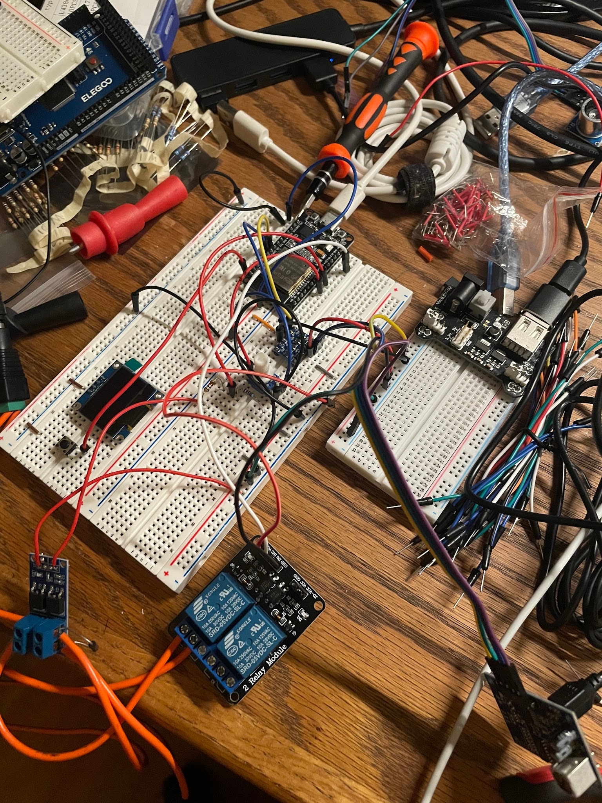
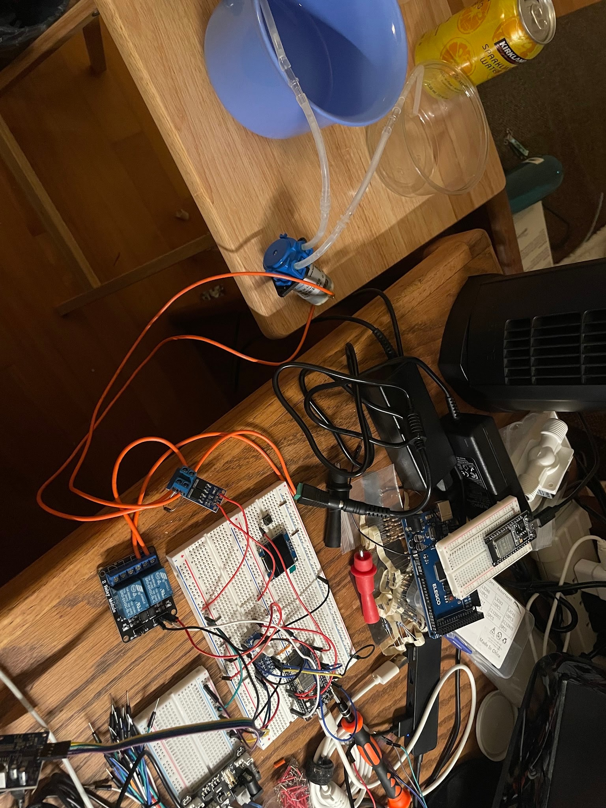
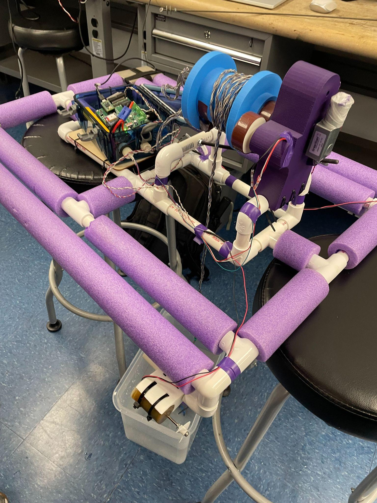
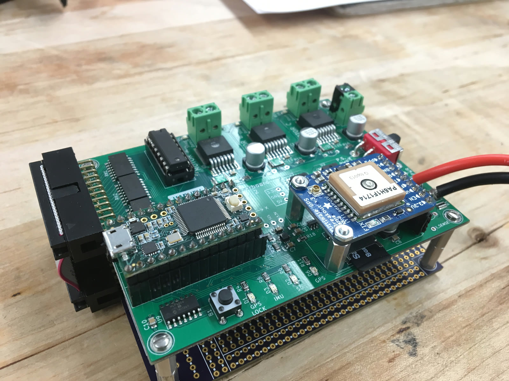
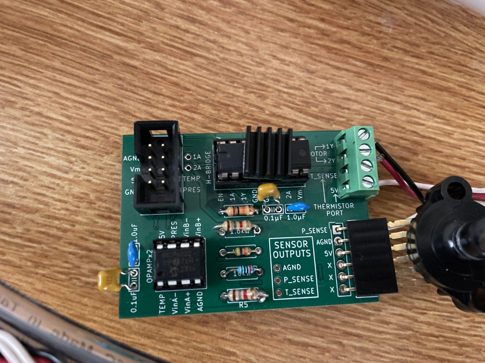
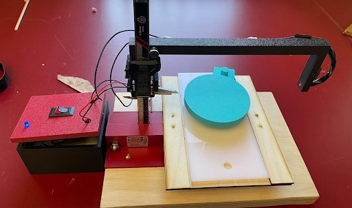
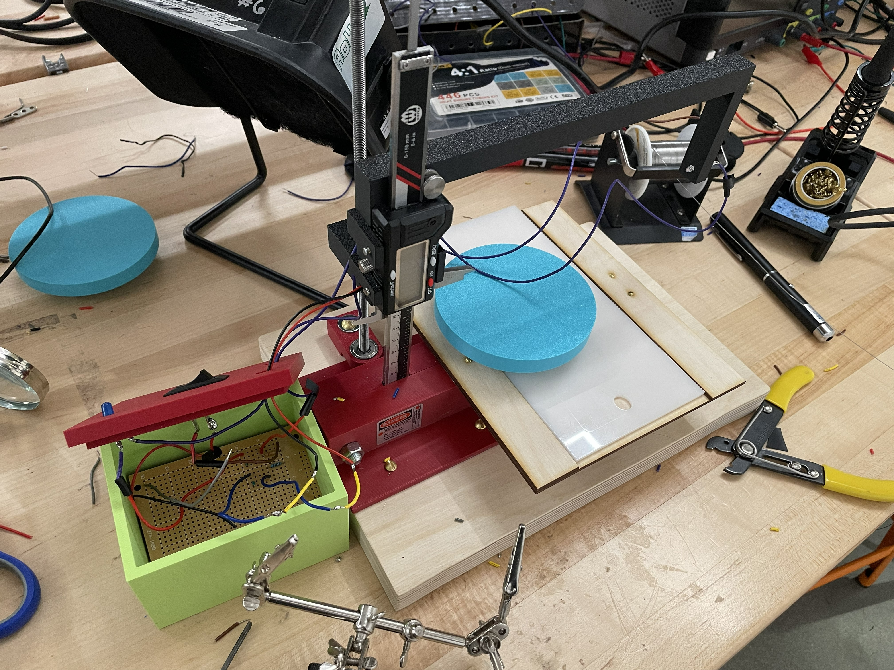
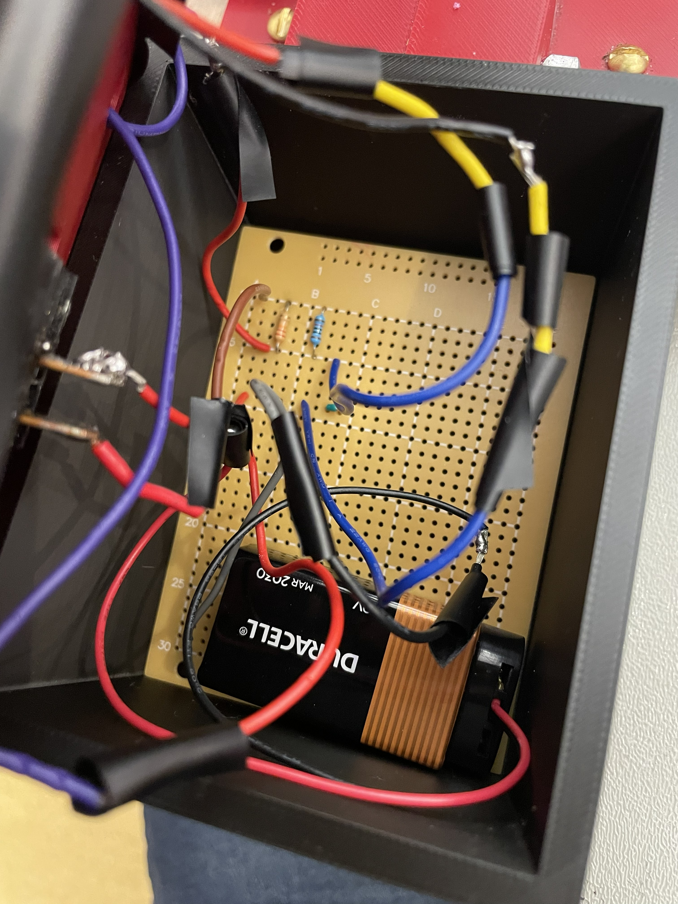
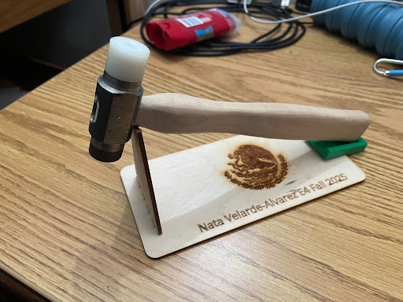
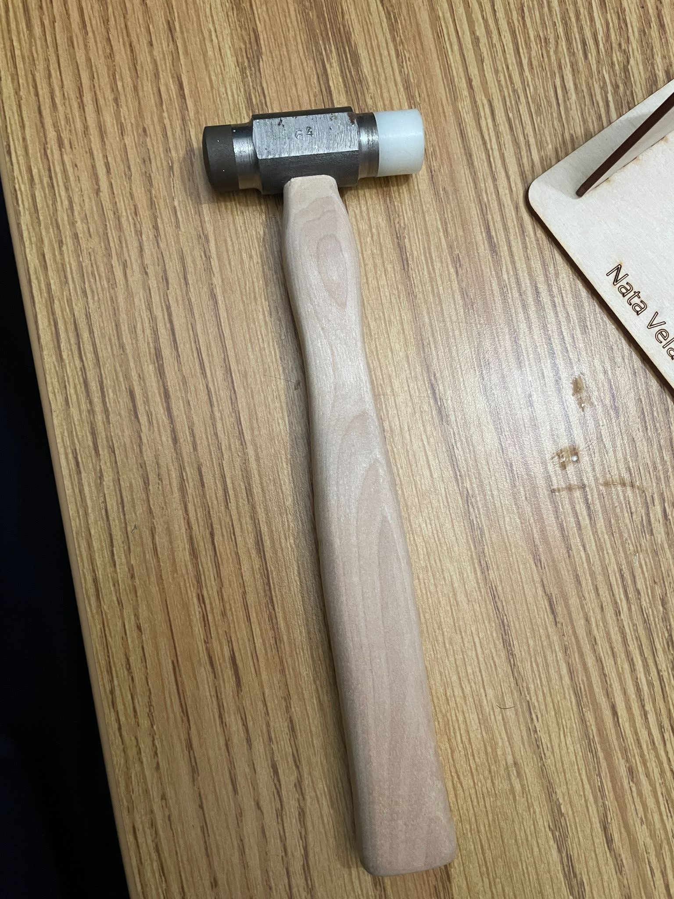

---

## Closed-Loop Water Level Control System

::: {layout-ncol="2"}

:::

I built a closed-loop water level/flow control system to stop water from a leaking supply line from overflowing a bucket at home. An ESP32 reads the sensor feedback and runs a PI control loop to regulate the pump's flow rate under varying conditions, actuating the pump through PWM. A relay module switches pump power, and an OLED display shows the live duty cycle and volumetric flow rate. The system can also be monitored and controlled remotely over Bluetooth from a phone.

**Skills:**
Electronics Design, Embedded C/C++, Microcontrollers, PI/PWM Control, Sensor Integration, PCB Design, Bluetooth Communication

---

## Autonomous Vertical Profiling Surface Vehicle

Experimental Engineering (E80) Team Project

::: {layout-ncol="2"}

:::

**Project Objective:** Design, build, integrate, calibrate, and field test an underwater autonomous robot that measures turbidity and total dissolved solids (TDS) at different depths in clear water, lake, and ocean environments using a controlled motor-propeller and three sensors.

**Project Concept:** Build the vehicle with all control system components, including the mechanical structure, a water-proof electronics housing, custom instrumentation circuits for the turbidity and TDS sensors, PWM motor control for vertical descent, PID depth control with feedback, sensor data acquisition and storage, and user presets for underwater depth sampling.

In a team, we built, tested, and integrated the vehicle from the ground up, then calibrated and field tested it in the lab tank room, a local lake, and at Dana Point.

**Skills:**
Electronics Design, Embedded Systems, PCB Design, PID/PWM Control, Sensor Integration & Calibration, LabVIEW, Waterproofing, Mechanical Assembly, Field Testing

**Key Contributions:**

- Implemented PID control through a LabVIEW program to control the vehicle's descent depth
- Designed PCBs for the motor driver, pressure sensor, and thermistor voltage divider, and for sensor interfacing
- Developed the sensor interface circuits for the turbidity and TDS instrumentation
- Integrated the sensor electronics with a Teensy microcontroller inside a waterproof enclosure
- Built a two-tier board stack with a main motor controller board and an I/O sensor protoboard
- Assembled the mechanical frame with the electronics housing
- Calibrated sensors against industrial references and validated performance in tank, lake, and ocean testing

---

## Remotely Operated Vertical Diving Vehicle

Experimental Engineering (E80) Team Project — Electrical, Mechanical Systems & Control

::: {layout-ncol="2"}

:::

*More details and photos coming soon.*

**Skills:**

---

## Height Gauge for Microscopy Samples
   Team Design Project

Background: Australian university lab analyzes powdered samples using an electron micrscope. Our client needed a better method for measuring the height of samples between 0 mm and 30 mm, a more accurate and precise method than using a ruler, and time efficient method.

<video controls playsinline style="width: 100%;">
  <source src="images/0819-web.mp4" type="video/mp4">
</video>

In a team of 5 students, we designed and built a height gauge for measuring the microscopy samples. The design is a laser-caliper system. It was capable of measuring within 0.01 mm of precision. I took the lead in designing the electronics and circuit for the laser detection field.

**Skills:**
Prototyping, Circuit Design, Breadboarding, Soldering, CAD, 3D Printing, Laser Cutting, Electronics Assembly, Prototype Testing

**Key Contributions:**

- Designed circuit with resistors, LED, on-off switch, low-voltage fine point laser, and photodiode to create a linear detection field
- LED indicator to indicate when sample crosses linear laser field.
- Prepared drawings for 12 individual parts and full assembly, and bill of materials using SolidWorks CAD.
- Improved height measurement technique by increasing precision from 0.1 mm to 0.01 mm.
- Validated effectiveness with different colored powdered and solid samples.

---

## Machined Hammer

Manufacturing (E4) Project

::: {layout-ncol="2"}

:::

Machined a hammer with precision following specifications from technical drawings and process routers. Machined handle using a vertical bandsaw and sanding to achieve a smooth finish. Machined AISI 1015 steel head, AISI 4340 hard face, and nylon soft face using lathe and mill. Heat treated hard face to achieve desired hardness. Tolerances were checked using micrometers and calipers.

**Skills:**  
Manufacturing, Precision machining, Tolerancing, heat treatment, quality control
Lathe, Mill, Bandsaw, Router, Sandblaster

---

